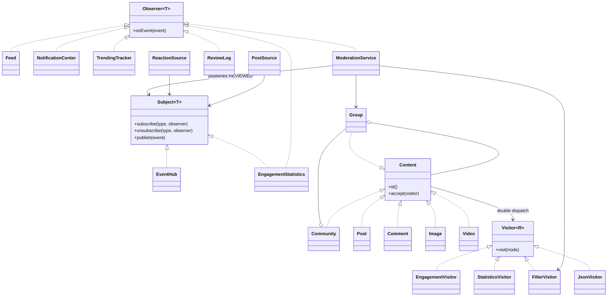

# Social network

Assignment 6, variant 16. Java 17 and JUnit 5. A console simulation of posts, reactions and moderation.

## Run

Install JDK 17 and Maven, then run from this directory:

```sh
mvn test
mvn -q -DskipTests package
java -cp target/classes social.Main 4
```

The optional argument is the producer thread count, default 3, minimum 3. Each producer publishes 100 posts and 100 reactions. The model tree is an immutable initial content snapshot. Live events update the feed, notifications and live statistics, not that snapshot. Visitor results on the snapshot are therefore distinct from the live counters.

## Design decisions

Push: each immutable Event carries all values needed by its observers. There is no second read from changing source state. PostSource and ReactionSource publish through two independently constructed EventHub subjects.

EventHub has per-type CopyOnWriteArrayList registries. The EnumMap is fully built in the constructor and never structurally modified afterwards. No whole-subject lock is held while callbacks run. Addition/removal affects future iterator snapshots. A removed observer may still receive an event already being dispatched, including several in-flight events from different threads. A new observer cannot receive an event whose iterator snapshot predates the subscription. Exceptions are collected and rethrown after all listeners in the snapshot are attempted.

EngagementStatistics is both Observer and Subject. It atomically totals reactions per group and publishes SUMMARY events. Concurrent publishers can deliver older summaries after newer ones; TrendingTracker merges with max, so its cumulative score cannot decrease. This assumes positive-only reactions: unlike/dislike removal is outside this simulation.

Visitors own traversal. Container nodes store immutable lists and dispatch to a visitor; they do not implement calculations. EngagementVisitor sums likes, StatisticsVisitor accumulates the number of visited containers and leaves, FilterVisitor returns matching elements. Each StatisticsVisitor belongs to one traversal and is never shared between threads. Stateless visitors can be reused with thread-safe predicates.

ModerationService observes REPORTED, resolves only the related group, runs FilterVisitor and publishes REVIEWED. The demo rule flags Post/Comment text containing `spam`. This is a deterministic teaching example, not a production moderation classifier.

Main is the composition root. Collaborators are injected through constructors. Mutable listener state uses concurrent collections. ProducerRunner owns the lifecycle of its injected ExecutorService: normal completion waits for all tasks and synchronous callbacks, then checks every Future for errors. Timeout/interruption is an explicitly reported failure, not a guarantee of delivery for cancelled work. The supplied producer loops terminate and contain no blocking external I/O.

Several package-private classes are grouped in Sources.java, Content.java, Visitors.java and Listeners.java by responsibility to keep the teaching project compact. Java allows this; each public type has a matching filename.

## Tests

JUnit tests cover routing, subscriptions inside callbacks, concurrent unsubscribe snapshot behavior, callback failures, observer chains, immutable lists, hand-calculated visitor results, subtree integration and producer shutdown. Stress test: four producers each publish 1000 reactions. Expected: exactly 4000 delivered reactions, 4000 summary notifications, group total 4000, trending score 4000, terminated executor.

## UML



## Trade-off proof

Commit `Add JSON visitor without changing content elements` changes exactly:
- `src/main/java/social/JsonVisitor.java`
- `src/test/java/social/SocialNetworkTest.java`
- `README.md`

No Content element or Visitor interface was changed. A new operation is inexpensive: implement the existing overloads in a new visitor and add tests. JsonVisitor writes nested JSON manually, including escaping quotes, backslashes and every control character below U+0020.

Commit `Add Video element and update all visitors` changes exactly:
- `src/main/java/social/Video.java`
- `src/main/java/social/Visitor.java`
- `src/main/java/social/Visitors.java`
- `src/main/java/social/JsonVisitor.java`
- `src/main/java/social/Main.java`
- `src/test/java/social/SocialNetworkTest.java`
- `README.md`

A new element requires a new interface overload and corresponding implementations in EVERY visitor. This is the main Visitor trade-off: choose it when element types are stable but operations change often. Avoid it when new content types are added constantly by independent plugins.

## Hand-calculated expectations

The immutable demo tree has 1 Community, 2 Groups and 5 leaves: Post p1=10 likes, Comment c1=2, Image i1=3, Video v1=5, Post p2=4. Total likes = 24; total nodes = 8. Filtering comments yields only c1. Reviewing java yields c1 and does not visit games, where p2 also contains spam.

With 4 producers: 400 posts in Feed, 800 notifications, 400 live reactions, trending score 400, one REVIEWED result containing c1. All counters are printed after producers finish.

## Submission status

The repository has real implementation commits. It does not claim two weeks of development: that requirement can only be met by continuing actual work over the course period. Upload the repository to your GitHub, prepare the LMS report and submit both. Variant uniqueness in your group and the defense remain your responsibility.


## Verified result

Compiled with Java 17. All 24 tests passed under the real JUnit Platform Console 1.11.4 / Jupiter 5.11.4. Main completed with 4 producer threads and the counts shown above. Maven itself was not installed in the verification environment; the documented Maven command is the user setup path.
