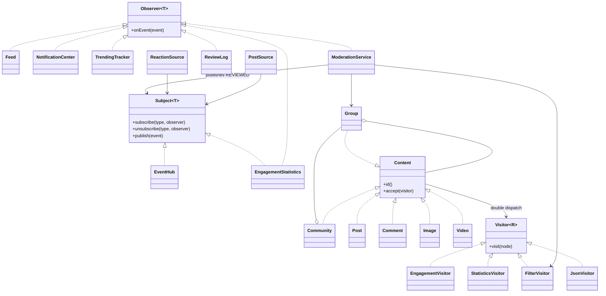

# Social network

## 1. Архитектура и полный код

Все Java-файлы используют пакет social. В некоторых файлах несколько package-private классов; это допустимый синтаксис Java.

| Путь | Назначение |
|---|---|
| `pom.xml` | Настройки Maven |
| `src/main/java/social/Event.java` | Исходный код |
| `src/main/java/social/Observer.java` | Исходный код |
| `src/main/java/social/Subject.java` | Исходный код |
| `src/main/java/social/EventHub.java` | Исходный код |
| `src/main/java/social/Sources.java` | Исходный код |
| `src/main/java/social/Content.java` | Исходный код |
| `src/main/java/social/Video.java` | Исходный код |
| `src/main/java/social/Visitor.java` | Исходный код |
| `src/main/java/social/Visitors.java` | Исходный код |
| `src/main/java/social/JsonVisitor.java` | Исходный код |
| `src/main/java/social/Listeners.java` | Исходный код |
| `src/main/java/social/ProducerRunner.java` | Исходный код |
| `src/main/java/social/Main.java` | Исходный код |
| `src/test/java/social/SocialNetworkTest.java` | Тесты |
| `README.md` | Документация |

## pom.xml

````xml
<project xmlns="http://maven.apache.org/POM/4.0.0"
         xmlns:xsi="http://www.w3.org/2001/XMLSchema-instance"
         xsi:schemaLocation="http://maven.apache.org/POM/4.0.0 https://maven.apache.org/xsd/maven-4.0.0.xsd">
    <modelVersion>4.0.0</modelVersion>
    <groupId>social</groupId>
    <artifactId>social-network</artifactId>
    <version>1.0</version>
    <properties>
        <maven.compiler.release>17</maven.compiler.release>
        <project.build.sourceEncoding>UTF-8</project.build.sourceEncoding>
    </properties>
    <dependencies>
        <dependency>
            <groupId>org.junit.jupiter</groupId>
            <artifactId>junit-jupiter</artifactId>
            <version>5.11.4</version>
            <scope>test</scope>
        </dependency>
    </dependencies>
    <build>
        <plugins>
            <plugin>
                <groupId>org.apache.maven.plugins</groupId>
                <artifactId>maven-compiler-plugin</artifactId>
                <version>3.13.0</version>
            </plugin>
            <plugin>
                <groupId>org.apache.maven.plugins</groupId>
                <artifactId>maven-surefire-plugin</artifactId>
                <version>3.5.2</version>
            </plugin>
        </plugins>
    </build>
</project>

````

## src/main/java/social/Event.java

````java
package social;

import java.util.Objects;

public record Event(EventType type, String groupId, String contentId,
                    String message, long value) {
    public Event {
        Objects.requireNonNull(type);
        Objects.requireNonNull(groupId);
        Objects.requireNonNull(contentId);
        Objects.requireNonNull(message);
        if (value < 0) throw new IllegalArgumentException("Negative value");
    }
}

enum EventType { POSTED, REACTED, REPORTED, SUMMARY, REVIEWED }

````

## src/main/java/social/Observer.java

````java
package social;

@FunctionalInterface
public interface Observer<T> {
    void onEvent(T event);
}

````

## src/main/java/social/Subject.java

````java
package social;

public interface Subject<T> {
    void subscribe(EventType type, Observer<T> observer);
    void unsubscribe(EventType type, Observer<T> observer);
    void publish(T event);
}

````

## src/main/java/social/EventHub.java

````java
package social;

import java.util.EnumMap;
import java.util.Map;
import java.util.Objects;
import java.util.concurrent.CopyOnWriteArrayList;

public final class EventHub implements Subject<Event> {
    private final Map<EventType, CopyOnWriteArrayList<Observer<Event>>> listeners;

    public EventHub() {
        listeners = new EnumMap<>(EventType.class);
        for (EventType type : EventType.values()) {
            listeners.put(type, new CopyOnWriteArrayList<>());
        }
    }

    public void subscribe(EventType type, Observer<Event> observer) {
        listeners.get(type).addIfAbsent(Objects.requireNonNull(observer));
    }

    public void unsubscribe(EventType type, Observer<Event> observer) {
        listeners.get(type).remove(observer);
    }

    public void publish(Event event) {
        RuntimeException failure = null;
        for (Observer<Event> observer : listeners.get(event.type())) {
            try {
                observer.onEvent(event);
            } catch (RuntimeException exception) {
                if (failure == null) failure = new RuntimeException("Listener failed");
                failure.addSuppressed(exception);
            }
        }
        if (failure != null) throw failure;
    }
}

````

## src/main/java/social/Sources.java

````java
package social;

final class PostSource {
    private final Subject<Event> events;

    PostSource(Subject<Event> events) { this.events = events; }

    void post(String groupId, String contentId, String text) {
        events.publish(new Event(EventType.POSTED, groupId, contentId, text, 0));
    }

    void report(String groupId, String contentId) {
        events.publish(new Event(EventType.REPORTED, groupId, contentId, "Review requested", 0));
    }
}

final class ReactionSource {
    private final Subject<Event> events;

    ReactionSource(Subject<Event> events) { this.events = events; }

    void like(String groupId, String contentId) {
        events.publish(new Event(EventType.REACTED, groupId, contentId, "Like", 1));
    }
}

````

## src/main/java/social/Content.java

````java
package social;

import java.util.List;

interface Content {
    String id();
    <R> R accept(Visitor<R> visitor);
}

record Community(String id, List<Group> groups) implements Content {
    Community { groups = List.copyOf(groups); }
    public <R> R accept(Visitor<R> visitor) { return visitor.visit(this); }
}

record Group(String id, List<Content> children) implements Content {
    Group { children = List.copyOf(children); }
    public <R> R accept(Visitor<R> visitor) { return visitor.visit(this); }
}

record Post(String id, String text, long likes) implements Content {
    public <R> R accept(Visitor<R> visitor) { return visitor.visit(this); }
}

record Comment(String id, String text, long likes) implements Content {
    public <R> R accept(Visitor<R> visitor) { return visitor.visit(this); }
}

record Image(String id, String caption, long likes) implements Content {
    public <R> R accept(Visitor<R> visitor) { return visitor.visit(this); }
}

````

## src/main/java/social/Video.java

````java
package social;

record Video(String id, String title, long likes) implements Content {
    public <R> R accept(Visitor<R> visitor) { return visitor.visit(this); }
}

````

## src/main/java/social/Visitor.java

````java
package social;

interface Visitor<R> {
    R visit(Community community);
    R visit(Group group);
    R visit(Post post);
    R visit(Comment comment);
    R visit(Image image);
    R visit(Video video);
}

````

## src/main/java/social/Visitors.java

````java
package social;

import java.util.ArrayList;
import java.util.List;
import java.util.function.Predicate;

final class EngagementVisitor implements Visitor<Long> {
    private long sum(List<? extends Content> children) {
        return children.stream().mapToLong(child -> child.accept(this)).sum();
    }
    public Long visit(Community node) { return sum(node.groups()); }
    public Long visit(Group node) { return sum(node.children()); }
    public Long visit(Post node) { return node.likes(); }
    public Long visit(Comment node) { return node.likes(); }
    public Long visit(Image node) { return node.likes(); }
    public Long visit(Video node) { return node.likes(); }
}

final class StatisticsVisitor implements Visitor<Integer> {
    private int total;
    int total() { return total; }

    private int count(List<? extends Content> children) {
        total++;
        for (Content child : children) child.accept(this);
        return total;
    }
    public Integer visit(Community node) { return count(node.groups()); }
    public Integer visit(Group node) { return count(node.children()); }
    public Integer visit(Post node) { return ++total; }
    public Integer visit(Comment node) { return ++total; }
    public Integer visit(Image node) { return ++total; }
    public Integer visit(Video node) { return ++total; }
}

final class FilterVisitor implements Visitor<List<Content>> {
    private final Predicate<Content> condition;
    FilterVisitor(Predicate<Content> condition) { this.condition = condition; }

    private List<Content> match(Content node) {
        return condition.test(node) ? List.of(node) : List.of();
    }
    private List<Content> collect(Content node, List<? extends Content> children) {
        List<Content> result = new ArrayList<>(match(node));
        for (Content child : children) result.addAll(child.accept(this));
        return result;
    }
    public List<Content> visit(Community node) { return collect(node, node.groups()); }
    public List<Content> visit(Group node) { return collect(node, node.children()); }
    public List<Content> visit(Post node) { return match(node); }
    public List<Content> visit(Comment node) { return match(node); }
    public List<Content> visit(Image node) { return match(node); }
    public List<Content> visit(Video node) { return match(node); }
}

````

## src/main/java/social/JsonVisitor.java

````java
package social;

import java.util.List;
import java.util.stream.Collectors;

final class JsonVisitor implements Visitor<String> {
    private String quote(String text) {
        StringBuilder result = new StringBuilder("\"");
        for (char c : text.toCharArray()) {
            if (c == '"' || c == '\\') result.append('\\').append(c);
            else if (c < 32) result.append(String.format("\\u%04x", (int) c));
            else result.append(c);
        }
        return result.append('"').toString();
    }

    private String container(String type, String id, List<? extends Content> children) {
        String items = children.stream().map(child -> child.accept(this)).collect(Collectors.joining(","));
        return "{\"type\":" + quote(type) + ",\"id\":" + quote(id) + ",\"children\":[" + items + "]}";
    }

    private String leaf(String type, String id, String text, long likes) {
        return "{\"type\":" + quote(type) + ",\"id\":" + quote(id)
                + ",\"text\":" + quote(text) + ",\"likes\":" + likes + "}";
    }

    public String visit(Community node) { return container("community", node.id(), node.groups()); }
    public String visit(Group node) { return container("group", node.id(), node.children()); }
    public String visit(Post node) { return leaf("post", node.id(), node.text(), node.likes()); }
    public String visit(Comment node) { return leaf("comment", node.id(), node.text(), node.likes()); }
    public String visit(Image node) { return leaf("image", node.id(), node.caption(), node.likes()); }
    public String visit(Video node) { return leaf("video", node.id(), node.title(), node.likes()); }
}

````

## src/main/java/social/Listeners.java

````java
package social;

import java.util.List;
import java.util.Map;
import java.util.concurrent.ConcurrentHashMap;
import java.util.concurrent.ConcurrentLinkedQueue;
import java.util.function.Predicate;

final class Feed implements Observer<Event> {
    private final ConcurrentLinkedQueue<Event> posts = new ConcurrentLinkedQueue<>();
    public void onEvent(Event event) { posts.add(event); }
    int size() { return posts.size(); }
}

final class NotificationCenter implements Observer<Event> {
    private final ConcurrentLinkedQueue<Event> messages = new ConcurrentLinkedQueue<>();
    public void onEvent(Event event) { messages.add(event); }
    int size() { return messages.size(); }
}

final class EngagementStatistics implements Observer<Event>, Subject<Event> {
    private final Subject<Event> summaries;
    private final ConcurrentHashMap<String, Long> totals = new ConcurrentHashMap<>();

    EngagementStatistics(Subject<Event> summaries) { this.summaries = summaries; }

    public void onEvent(Event event) {
        long total = totals.merge(event.groupId(), event.value(), Long::sum);
        publish(new Event(EventType.SUMMARY, event.groupId(), "", "Total reactions", total));
    }
    long total(String groupId) { return totals.getOrDefault(groupId, 0L); }
    public void subscribe(EventType type, Observer<Event> observer) { summaries.subscribe(type, observer); }
    public void unsubscribe(EventType type, Observer<Event> observer) { summaries.unsubscribe(type, observer); }
    public void publish(Event event) { summaries.publish(event); }
}

final class TrendingTracker implements Observer<Event> {
    private final ConcurrentHashMap<String, Long> scores = new ConcurrentHashMap<>();
    public void onEvent(Event event) {
        scores.merge(event.groupId(), event.value(), Long::max);
    }
    long score(String groupId) { return scores.getOrDefault(groupId, 0L); }
}

final class ModerationService implements Observer<Event> {
    private final Map<String, Group> groups;
    private final Predicate<Content> rule;
    private final Subject<Event> reviews;

    ModerationService(Map<String, Group> groups, Predicate<Content> rule, Subject<Event> reviews) {
        this.groups = Map.copyOf(groups);
        this.rule = rule;
        this.reviews = reviews;
    }
    public void onEvent(Event event) {
        Group group = groups.get(event.groupId());
        if (group == null) throw new IllegalArgumentException("Unknown group: " + event.groupId());
        List<Content> matches = group.accept(new FilterVisitor(rule));
        String ids = matches.stream().map(Content::id).collect(java.util.stream.Collectors.joining(","));
        reviews.publish(new Event(EventType.REVIEWED, group.id(), event.contentId(), ids, matches.size()));
    }
}

final class ReviewLog implements Observer<Event> {
    private final ConcurrentLinkedQueue<Event> reviews = new ConcurrentLinkedQueue<>();
    public void onEvent(Event event) { reviews.add(event); }
    List<Event> entries() { return List.copyOf(reviews); }
}

````

## src/main/java/social/ProducerRunner.java

````java
package social;

import java.util.List;
import java.util.ArrayList;
import java.util.concurrent.ExecutorService;
import java.util.concurrent.Future;
import java.util.concurrent.TimeUnit;

final class ProducerRunner {
    private final ExecutorService executor;
    ProducerRunner(ExecutorService executor) { this.executor = executor; }

    void run(List<Runnable> producers) throws Exception {
        List<Future<?>> results = new ArrayList<>();
        try {
            for (Runnable producer : producers) results.add(executor.submit(producer));
            executor.shutdown();
            if (!executor.awaitTermination(30, TimeUnit.SECONDS)) {
                throw new IllegalStateException("Producers timed out");
            }
            for (Future<?> result : results) result.get();
        } catch (InterruptedException exception) {
            Thread.currentThread().interrupt();
            throw exception;
        } finally {
            if (!executor.isTerminated()) {
                executor.shutdownNow();
                executor.awaitTermination(5, TimeUnit.SECONDS);
            }
        }
    }
}

````

## src/main/java/social/Main.java

````java
package social;

import java.util.List;
import java.util.ArrayList;
import java.util.Map;
import java.util.concurrent.Executors;
import java.util.function.Predicate;

public final class Main {
    public static void main(String[] args) throws Exception {
        int threads = args.length == 0 ? 3 : Integer.parseInt(args[0]);
        if (threads < 3) throw new IllegalArgumentException("Use at least 3 threads");

        Group java = new Group("java", List.of(new Post("p1", "Patterns", 10),
                new Comment("c1", "spam link", 2), new Image("i1", "Diagram", 3),
                new Video("v1", "Java tutorial", 5)));
        Group games = new Group("games", List.of(new Post("p2", "spam offer", 4)));
        Community community = new Community("campus", List.of(java, games));

        EventHub postEvents = new EventHub();
        EventHub reactionEvents = new EventHub();
        EventHub reviewEvents = new EventHub();
        PostSource posts = new PostSource(postEvents);
        ReactionSource reactions = new ReactionSource(reactionEvents);
        Feed feed = new Feed();
        NotificationCenter notifications = new NotificationCenter();
        EngagementStatistics statistics = new EngagementStatistics(new EventHub());
        TrendingTracker trending = new TrendingTracker();
        ReviewLog reviewLog = new ReviewLog();
        Predicate<Content> rule = node ->
                node instanceof Post post && post.text().contains("spam") ||
                node instanceof Comment comment && comment.text().contains("spam");
        ModerationService moderation = new ModerationService(
                Map.of(java.id(), java, games.id(), games), rule, reviewEvents);

        postEvents.subscribe(EventType.POSTED, feed);
        postEvents.subscribe(EventType.POSTED, notifications);
        postEvents.subscribe(EventType.REPORTED, moderation);
        reactionEvents.subscribe(EventType.REACTED, notifications);
        reactionEvents.subscribe(EventType.REACTED, statistics);
        statistics.subscribe(EventType.SUMMARY, trending);
        reviewEvents.subscribe(EventType.REVIEWED, reviewLog);

        List<Runnable> producers = new ArrayList<>();
        for (int i = 0; i < threads; i++) {
            int producer = i;
            producers.add(() -> {
                for (int j = 0; j < 100; j++) {
                    posts.post("java", "live-" + producer + "-" + j, "New post");
                    reactions.like("java", "p1");
                }
            });
        }
        new ProducerRunner(Executors.newFixedThreadPool(threads)).run(producers);
        posts.report("java", "c1");

        System.out.println("Feed: " + feed.size());
        System.out.println("Notifications: " + notifications.size());
        System.out.println("Live reactions: " + statistics.total("java"));
        System.out.println("Trending score: " + trending.score("java"));
        System.out.println("Snapshot engagement: " + community.accept(new EngagementVisitor()));
        System.out.println("Snapshot nodes: " + community.accept(new StatisticsVisitor()));
        System.out.println("Review: " + reviewLog.entries());
        System.out.println(community.accept(new JsonVisitor()));
    }
}

````

## src/test/java/social/SocialNetworkTest.java

````java
package social;

import org.junit.jupiter.api.Test;
import org.junit.jupiter.api.Timeout;
import static org.junit.jupiter.api.Assertions.*;

import java.util.List;
import java.util.ArrayList;
import java.util.Map;
import java.util.concurrent.CyclicBarrier;
import java.util.concurrent.CountDownLatch;
import java.util.concurrent.Executors;
import java.util.concurrent.TimeUnit;
import java.util.concurrent.ExecutionException;
import java.util.concurrent.atomic.AtomicInteger;

@Timeout(40)
class SocialNetworkTest {
    private Event reaction() { return new Event(EventType.REACTED, "java", "p1", "Like", 1); }
    private Group group() {
        return new Group("java", List.of(new Post("p1", "Hello", 10),
                new Comment("c1", "spam link", 2), new Image("i1", "Diagram", 3),
                new Video("v1", "Java tutorial", 5)));
    }
    private Community community() {
        return new Community("campus", List.of(group(),
                new Group("games", List.of(new Post("p2", "spam offer", 4)))));
    }

    @Test void deliversToSubscribers() {
        EventHub hub = new EventHub();
        AtomicInteger a = new AtomicInteger();
        AtomicInteger b = new AtomicInteger();
        hub.subscribe(EventType.REACTED, event -> a.incrementAndGet());
        hub.subscribe(EventType.REACTED, event -> b.incrementAndGet());
        hub.publish(reaction());
        assertEquals(1, a.get());
        assertEquals(1, b.get());
    }

    @Test void filtersEventTypes() {
        EventHub hub = new EventHub();
        AtomicInteger calls = new AtomicInteger();
        hub.subscribe(EventType.POSTED, event -> calls.incrementAndGet());
        hub.publish(reaction());
        assertEquals(0, calls.get());
    }

    @Test void duplicateSubscriptionIsIgnored() {
        EventHub hub = new EventHub();
        AtomicInteger calls = new AtomicInteger();
        Observer<Event> observer = event -> calls.incrementAndGet();
        hub.subscribe(EventType.REACTED, observer);
        hub.subscribe(EventType.REACTED, observer);
        hub.publish(reaction());
        assertEquals(1, calls.get());
    }

    @Test void listenerCanUnsubscribeInsideHandler() {
        EventHub hub = new EventHub();
        AtomicInteger calls = new AtomicInteger();
        Observer<Event> observer = new Observer<>() {
            public void onEvent(Event event) {
                calls.incrementAndGet();
                hub.unsubscribe(event.type(), this);
            }
        };
        hub.subscribe(EventType.REACTED, observer);
        hub.publish(reaction());
        hub.publish(reaction());
        assertEquals(1, calls.get());
    }

    @Test void listenerCanSubscribeInsideHandler() {
        EventHub hub = new EventHub();
        AtomicInteger calls = new AtomicInteger();
        Observer<Event> late = event -> calls.incrementAndGet();
        hub.subscribe(EventType.REACTED, event -> hub.subscribe(EventType.REACTED, late));
        hub.publish(reaction());
        assertEquals(0, calls.get());
        hub.publish(reaction());
        assertEquals(1, calls.get());
    }

    @Test void concurrentRemovalKeepsCurrentSnapshot() throws Exception {
        EventHub hub = new EventHub();
        CountDownLatch entered = new CountDownLatch(1);
        CountDownLatch release = new CountDownLatch(1);
        AtomicInteger calls = new AtomicInteger();
        Observer<Event> observer = event -> calls.incrementAndGet();
        hub.subscribe(EventType.REACTED, event -> {
            entered.countDown();
            try { release.await(); }
            catch (InterruptedException e) { Thread.currentThread().interrupt(); }
        });
        hub.subscribe(EventType.REACTED, observer);
        var pool = Executors.newSingleThreadExecutor();
        try {
            var result = pool.submit(() -> hub.publish(reaction()));
            assertTrue(entered.await(5, TimeUnit.SECONDS));
            hub.unsubscribe(EventType.REACTED, observer);
            release.countDown();
            result.get(5, TimeUnit.SECONDS);
            hub.publish(reaction());
            assertEquals(1, calls.get());
        } finally {
            release.countDown();
            pool.shutdownNow();
            assertTrue(pool.awaitTermination(5, TimeUnit.SECONDS));
        }
    }

    @Test void failureDoesNotSkipOtherSubscribers() {
        EventHub hub = new EventHub();
        AtomicInteger calls = new AtomicInteger();
        hub.subscribe(EventType.REACTED, event -> { throw new IllegalStateException(); });
        hub.subscribe(EventType.REACTED, event -> calls.incrementAndGet());
        assertThrows(RuntimeException.class, () -> hub.publish(reaction()));
        assertEquals(1, calls.get());
    }

    @Test void postSourceUpdatesFeed() {
        EventHub hub = new EventHub();
        Feed feed = new Feed();
        hub.subscribe(EventType.POSTED, feed);
        new PostSource(hub).post("java", "p1", "Hello");
        assertEquals(1, feed.size());
    }

    @Test void reactionSourceUpdatesStatistics() {
        EventHub hub = new EventHub();
        EngagementStatistics stats = new EngagementStatistics(new EventHub());
        hub.subscribe(EventType.REACTED, stats);
        new ReactionSource(hub).like("java", "p1");
        assertEquals(1, stats.total("java"));
    }

    @Test void observerChainUpdatesTrending() {
        EngagementStatistics stats = new EngagementStatistics(new EventHub());
        TrendingTracker trending = new TrendingTracker();
        stats.subscribe(EventType.SUMMARY, trending);
        stats.onEvent(reaction());
        stats.onEvent(reaction());
        assertEquals(2, trending.score("java"));
    }

    @Test void olderSummaryCannotLowerScore() {
        TrendingTracker trending = new TrendingTracker();
        trending.onEvent(new Event(EventType.SUMMARY, "java", "", "", 10));
        trending.onEvent(new Event(EventType.SUMMARY, "java", "", "", 4));
        assertEquals(10, trending.score("java"));
    }

    @Test void groupsHaveSeparateTotals() {
        EngagementStatistics stats = new EngagementStatistics(new EventHub());
        stats.onEvent(reaction());
        stats.onEvent(new Event(EventType.REACTED, "games", "p2", "Like", 3));
        assertEquals(1, stats.total("java"));
        assertEquals(3, stats.total("games"));
    }

    @Test void childListIsDefensivelyCopied() {
        List<Content> children = new ArrayList<>();
        children.add(new Post("p", "Hello", 1));
        Group group = new Group("g", children);
        children.clear();
        assertEquals(1, group.children().size());
        assertThrows(UnsupportedOperationException.class, () -> group.children().clear());
    }

    @Test void engagementMatchesHandCalculation() {
        assertEquals(24L, community().accept(new EngagementVisitor()).longValue());
    }

    @Test void statisticsAccumulateAcrossWholeTree() {
        StatisticsVisitor visitor = new StatisticsVisitor();
        community().accept(visitor);
        assertEquals(8, visitor.total());
    }

    @Test void filterReturnsOnlyComments() {
        List<Content> result = community().accept(new FilterVisitor(node -> node instanceof Comment));
        assertEquals(List.of("c1"), result.stream().map(Content::id).toList());
    }

    @Test void doubleDispatchWorksThroughContentReference() {
        Content node = new Image("i", "Photo", 12);
        assertEquals(12L, node.accept(new EngagementVisitor()).longValue());
    }

    @Test void reportInspectsOnlyRelatedGroupAndPublishesResult() {
        Community community = community();
        EventHub reviews = new EventHub();
        ReviewLog log = new ReviewLog();
        reviews.subscribe(EventType.REVIEWED, log);
        ModerationService moderation = new ModerationService(
                Map.of("java", community.groups().get(0), "games", community.groups().get(1)),
                node -> node.id().equals("c1") || node.id().equals("p2"), reviews);
        EventHub posts = new EventHub();
        posts.subscribe(EventType.REPORTED, moderation);
        new PostSource(posts).report("java", "c1");
        assertEquals(1, log.entries().size());
        assertEquals("c1", log.entries().get(0).message());
        assertEquals(1, log.entries().get(0).value());
    }

    @Test void unknownGroupIsReportedAsFailure() {
        ModerationService moderation = new ModerationService(Map.of(), node -> true, new EventHub());
        assertThrows(IllegalArgumentException.class, () -> moderation.onEvent(
                new Event(EventType.REPORTED, "missing", "p", "", 0)));
    }

    @Test void stressFourProducersPublishExactlyFourThousandEvents() throws Exception {
        EventHub hub = new EventHub();
        EngagementStatistics stats = new EngagementStatistics(new EventHub());
        TrendingTracker trending = new TrendingTracker();
        AtomicInteger delivered = new AtomicInteger();
        AtomicInteger summaries = new AtomicInteger();
        hub.subscribe(EventType.REACTED, stats);
        hub.subscribe(EventType.REACTED, event -> delivered.incrementAndGet());
        stats.subscribe(EventType.SUMMARY, trending);
        stats.subscribe(EventType.SUMMARY, event -> summaries.incrementAndGet());
        ReactionSource source = new ReactionSource(hub);
        CyclicBarrier start = new CyclicBarrier(4);
        List<Runnable> producers = new ArrayList<>();
        for (int i = 0; i < 4; i++) producers.add(() -> {
            try { start.await(5, TimeUnit.SECONDS); }
            catch (Exception e) { throw new IllegalStateException(e); }
            for (int j = 0; j < 1000; j++) source.like("java", "p1");
        });
        var pool = Executors.newFixedThreadPool(4);
        new ProducerRunner(pool).run(producers);
        assertTrue(pool.isTerminated());
        assertEquals(4000, delivered.get());
        assertEquals(4000, summaries.get());
        assertEquals(4000, stats.total("java"));
        assertEquals(4000, trending.score("java"));
    }

    @Test void producerFailureIsNotSilentlyIgnored() {
        var pool = Executors.newFixedThreadPool(3);
        assertThrows(ExecutionException.class, () -> new ProducerRunner(pool).run(
                List.of(() -> { throw new IllegalStateException("Failure"); })));
        assertTrue(pool.isTerminated());
    }

    @Test void jsonHasCorrectNestedStructure() {
        Community tree = new Community("c", List.of(new Group("g", List.of(new Post("p", "Hi", 2)))));
        String expected = "{\"type\":\"community\",\"id\":\"c\",\"children\":["
                + "{\"type\":\"group\",\"id\":\"g\",\"children\":["
                + "{\"type\":\"post\",\"id\":\"p\",\"text\":\"Hi\",\"likes\":2}]}]}";
        assertEquals(expected, tree.accept(new JsonVisitor()));
    }

    @Test void jsonEscapesQuotesBackslashesAndControlCharacters() {
        Post post = new Post("p", "\"\\\n\t\b", 0);
        assertEquals("{\"type\":\"post\",\"id\":\"p\",\"text\":\"\\\"\\\\\\u000a\\u0009\\u0008\",\"likes\":0}",
                post.accept(new JsonVisitor()));
    }

    @Test void newVideoElementWorksWithEveryVisitor() {
        Video video = new Video("v", "Tutorial", 5);
        assertEquals(5L, video.accept(new EngagementVisitor()).longValue());
        assertEquals(1, video.accept(new StatisticsVisitor()).intValue());
        assertEquals(List.of(video), video.accept(new FilterVisitor(node -> node instanceof Video)));
        assertEquals("{\"type\":\"video\",\"id\":\"v\",\"text\":\"Tutorial\",\"likes\":5}",
                video.accept(new JsonVisitor()));
    }
}

````

## README.md

````markdown
# Social network

Assignment 6, variant 16. Java 17 and JUnit 5. A console simulation of posts, reactions and moderation.

## Run

Install JDK 17 and Maven, then run from this directory:

```sh
mvn test
mvn -q -DskipTests package
java -cp target/classes social.Main 4
```

The optional argument is the producer thread count, default 3, minimum 3. Each producer publishes 100 posts and 100 reactions. The model tree is an immutable initial content snapshot. Live events update the feed, notifications and live statistics, not that snapshot. Visitor results on the snapshot are therefore distinct from the live counters.

## Design decisions

Push: each immutable Event carries all values needed by its observers. There is no second read from changing source state. PostSource and ReactionSource publish through two independently constructed EventHub subjects.

EventHub has per-type CopyOnWriteArrayList registries. The EnumMap is fully built in the constructor and never structurally modified afterwards. No whole-subject lock is held while callbacks run. Addition/removal affects future iterator snapshots. A removed observer may still receive an event already being dispatched, including several in-flight events from different threads. A new observer cannot receive an event whose iterator snapshot predates the subscription. Exceptions are collected and rethrown after all listeners in the snapshot are attempted.

EngagementStatistics is both Observer and Subject. It atomically totals reactions per group and publishes SUMMARY events. Concurrent publishers can deliver older summaries after newer ones; TrendingTracker merges with max, so its cumulative score cannot decrease. This assumes positive-only reactions: unlike/dislike removal is outside this simulation.

Visitors own traversal. Container nodes store immutable lists and dispatch to a visitor; they do not implement calculations. EngagementVisitor sums likes, StatisticsVisitor accumulates the number of visited containers and leaves, FilterVisitor returns matching elements. Each StatisticsVisitor belongs to one traversal and is never shared between threads. Stateless visitors can be reused with thread-safe predicates.

ModerationService observes REPORTED, resolves only the related group, runs FilterVisitor and publishes REVIEWED. The demo rule flags Post/Comment text containing `spam`. This is a deterministic teaching example, not a production moderation classifier.

Main is the composition root. Collaborators are injected through constructors. Mutable listener state uses concurrent collections. ProducerRunner owns the lifecycle of its injected ExecutorService: normal completion waits for all tasks and synchronous callbacks, then checks every Future for errors. Timeout/interruption is an explicitly reported failure, not a guarantee of delivery for cancelled work. The supplied producer loops terminate and contain no blocking external I/O.

Several package-private classes are grouped in Sources.java, Content.java, Visitors.java and Listeners.java by responsibility to keep the teaching project compact. Java allows this; each public type has a matching filename.

## Tests

JUnit tests cover routing, subscriptions inside callbacks, concurrent unsubscribe snapshot behavior, callback failures, observer chains, immutable lists, hand-calculated visitor results, subtree integration and producer shutdown. Stress test: four producers each publish 1000 reactions. Expected: exactly 4000 delivered reactions, 4000 summary notifications, group total 4000, trending score 4000, terminated executor.

## UML



## Trade-off proof

Commit `Add JSON visitor without changing content elements` changes exactly:
- `src/main/java/social/JsonVisitor.java`
- `src/test/java/social/SocialNetworkTest.java`
- `README.md`

No Content element or Visitor interface was changed. A new operation is inexpensive: implement the existing overloads in a new visitor and add tests. JsonVisitor writes nested JSON manually, including escaping quotes, backslashes and every control character below U+0020.

Commit `Add Video element and update all visitors` changes exactly:
- `src/main/java/social/Video.java`
- `src/main/java/social/Visitor.java`
- `src/main/java/social/Visitors.java`
- `src/main/java/social/JsonVisitor.java`
- `src/main/java/social/Main.java`
- `src/test/java/social/SocialNetworkTest.java`
- `README.md`

A new element requires a new interface overload and corresponding implementations in EVERY visitor. This is the main Visitor trade-off: choose it when element types are stable but operations change often. Avoid it when new content types are added constantly by independent plugins.

## Hand-calculated expectations

The immutable demo tree has 1 Community, 2 Groups and 5 leaves: Post p1=10 likes, Comment c1=2, Image i1=3, Video v1=5, Post p2=4. Total likes = 24; total nodes = 8. Filtering comments yields only c1. Reviewing java yields c1 and does not visit games, where p2 also contains spam.

With 4 producers: 400 posts in Feed, 800 notifications, 400 live reactions, trending score 400, one REVIEWED result containing c1. All counters are printed after producers finish.

## Submission status

The repository has real implementation commits. It does not claim two weeks of development: that requirement can only be met by continuing actual work over the course period. Upload the repository to your GitHub, prepare the LMS report and submit both. Variant uniqueness in your group and the defense remain your responsibility.


## Verified result

Compiled with Java 17. All 24 tests passed under the real JUnit Platform Console 1.11.4 / Jupiter 5.11.4. Main completed with 4 producer threads and the counts shown above. Maven itself was not installed in the verification environment; the documented Maven command is the user setup path.

````

## 2. Теория и соответствие требованиям

# Social network: разбор проекта

Вариант 16. Программа на Java 17 моделирует публикации, реакции и проверку жалоб. Observer передает события слушателям, Visitor выполняет операции над деревом контента.

## Теория: где и почему

Observer реализован интерфейсами Observer<T> и Subject<T>. EventHub хранит подписчиков по типам событий. PostSource публикует POSTED и REPORTED, ReactionSource публикует REACTED. Источникам не нужно знать классы слушателей. Добавление слушателя не требует переписывать источник.

Используется push: обработчик получает готовый неизменяемый Event. Ему не нужно отдельно спрашивать источник о текущем состоянии. EngagementStatistics одновременно слушает реакции и публикует SUMMARY. TrendingTracker получает эти сводки. Это цепочка наблюдателей.

Composite представлен деревом Community -> Group -> Post/Comment/Image/Video. Есть общий Content, два типа контейнеров и четыре типа листьев. Контейнеры используют List.copyOf, поэтому дерево нельзя менять через внешний список.

Visitor<R> содержит перегрузку visit для каждого типа элемента. Вызов content.accept(visitor) сначала выбирает accept конкретного элемента, затем visit(this) передает его конкретный тип посетителю. Это double dispatch. Прямой visitor.visit(content) не скомпилируется: перегрузки для общего Content нет. Обход находится в посетителях, а элементы содержат данные и accept.

EngagementVisitor суммирует лайки. StatisticsVisitor накапливает счетчик всех посещенных узлов. FilterVisitor получает условие через конструктор и возвращает список подходящих элементов. JsonVisitor вручную формирует вложенный JSON и экранирует специальные символы.

ModerationService получает REPORTED, находит соответствующую группу и запускает FilterVisitor только на ней. Идентификаторы найденного контента и количество нарушений отправляются новым событием REVIEWED в ReviewLog.

Main создает объекты и связывает зависимости: это composition root. Сервисы получают зависимости через конструкторы. ProducerRunner получает ExecutorService, завершает его и проверяет результаты задач. EventHub использует CopyOnWriteArrayList, агрегатор и тренды — ConcurrentHashMap, журналы — ConcurrentLinkedQueue. Stateful StatisticsVisitor создается для одного обхода и не разделяется потоками.

При отписке во время рассылки уже полученный снимок списка остается прежним. Поэтому обработчик может получить уже отправляемое событие, но его не будет в последующих снимках. Обработчик может сам подписывать и отписывать слушателей без ConcurrentModificationException.

## Соответствие требованиям

| Требование | Реализация |
|---|---|
| 2 источника | PostSource, ReactionSource и отдельные EventHub |
| Не менее 5 слушателей | Feed, NotificationCenter, EngagementStatistics, TrendingTracker, ModerationService, ReviewLog |
| Собственные generic-интерфейсы | Observer<T>, Subject<T>, Visitor<R> |
| Неизменяемые события с типом | record Event, enum EventType |
| Подписка по типу события | EventHub.subscribe(type, observer) |
| Подписка и отписка в обработчике | EventHub и соответствующие JUnit-тесты |
| Цепочка Observer | ReactionSource -> EngagementStatistics -> TrendingTracker |
| 3 уровня, 2 контейнера, 4 листа | Community -> Group -> Post/Comment/Image/Video |
| Double dispatch | accept(visitor) -> visit(this) |
| Числовой Visitor | EngagementVisitor |
| Visitor с накоплением состояния | StatisticsVisitor.total |
| Фильтр, возвращающий список | FilterVisitor |
| Вложенный JSON | JsonVisitor |
| Событие запускает Visitor на поддереве | ModerationService проверяет одну Group |
| Результат возвращается событием | REVIEWED -> ReviewLog |
| Не менее 3 producer threads | Main, аргумент threads, Executors.newFixedThreadPool |
| Настраиваемое количество потоков | java -cp target/classes social.Main 4 |
| Потокобезопасность без общей блокировки | ConcurrentHashMap, CopyOnWriteArrayList, ConcurrentLinkedQueue |
| Корректное завершение | ProducerRunner: shutdown, awaitTermination, Future.get |
| Composition root и constructor injection | Main, конструкторы сервисов |
| Два отдельных trade-off-коммита | 324a8d9 и 205e9bb |
| Не менее 15 JUnit-тестов | 24 теста в SocialNetworkTest |
| Стресс-тест 4 × 1000 | stressFourProducersPublishExactlyFourThousandEvents |
| Ручные ожидаемые значения | 24 лайка, 8 узлов, один комментарий c1 |
| README и UML | README.md |

## Проверка

Все 24 теста прошли на JUnit 5.11.4 с Java 17. При четырех потоках Main выводит Feed=400, Notifications=800, Live reactions=400, Trending score=400. Состояние дерева — исходный неизменяемый снимок: лайв-события обновляют слушателей, а не этот снимок. Поэтому 24 лайка в дереве и 400 новых реакций — разные показатели.

Нормальное завершение обрабатывает все принятые задачи. Ошибка обработчика или производителя видна вызывающему коду; аварийное прерывание/таймаут не выдается за успешное завершение без потерь.

## Что остается для сдачи

Проверить, что вариант 16 свободен в группе. Загрузить проект в свой GitHub и отправить ссылку вместе с отчетом в LMS. История содержит настоящие коммиты за текущую работу, но не заменяет требуемые две недели последовательной работы. Защита и live coding составляют 50 баллов и выполняются студентом.
